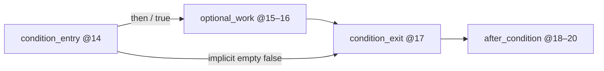

# Condition C4 完成证据报告

结论：限定 C4 已通过 Ubuntu 原生完整功能闭环。原有 30 项回归及新增 4 项均通过；独立保留的 58 条原生命令全部退出 0。完成后停止代码扩展。

## 假设和精确范围

单个、多行、带花括号、then 含正常语句且没有显式 else 的 if。条件仍由原始 C 表达式执行；用 C2D_FLAG 环境变量是否存在选择 true/false，逗号表达式计数证明两条路径均仅求值一次。return 只出现在函数末尾，不在分支中。信号量仅为既有 create/join/sem 依赖验收，不修改协议。不支持本轮外的嵌套、else-if、无花括号、同行语句、循环、switch、三元表达式或早期转移。不计算 WCET，不引入调度算法或虚假 else 执行节点。

## 根因与最小修复

修复前 `python3 -m unittest Code2DAG.tests.test_condition_c4 -v` 退出 1（4 项失败，见 c4_tests.stderr）。`_parse_if` 使用跳过空白后的 else 查找位置作为无 else 条件的结束位置；本例错误地把第 18 行 after_condition 纳入条件边界，遗漏其执行段。真实 blocks 和直接模型调用都在 after_condition 定位断言失败。

唯一生产改动：`Code2DAG/pipeline/condition_model.py::_parse_if`，无 else 时以 then_stmt.end 为结束位置，else 存在时以 else_stmt.end 为结束位置。没有修改图构建、映射规则、依赖定义或五算法。既有文件差异见 changes.patch。

其他文件：

- `Code2DAG/tests/test_condition_nested.py::native_acceptance`：验收辅助函数允许仅存在 outer 区域，支持 case 提供活动节点选择器；旧 C2/C3 默认路径保持原状并通过全回归。
- `Code2DAG/source_files/condition_c4/condition_c4.c`：真实 pthread/sem C4 用例。
- `Code2DAG/tests/test_condition_c4.py`：structure_check/project/active、两路径输出定义和 4 项回归（空 false 结构、两路径投影、五算法、完整原生流程）。结构测试直接防止 after_condition 遗漏重现；原生测试验证真实 RTL 节点映射。
- `Code2DAG/docs/condition_c4_validation.md`：本报告镜像。

## 已执行命令与退出码

工作目录 `/home/spcae/code2dag-condition`：

| 命令 | 结果 |
|---|---|
| python3 -m unittest discover -s Code2DAG/tests -v（修改前） | 退出 0，30 项通过；baseline_tests.stderr |
| python3 -m unittest Code2DAG.tests.test_condition_c4 -v（修复前） | 退出 1，4 项失败；c4_tests.stderr |
| python3 -m unittest Code2DAG.tests.test_condition_c4 -v（修复后） | 退出 0，4 项通过；c4_fixed_tests.stderr |
| python3 -m unittest discover -s Code2DAG/tests -v（修复后） | 退出 0，34 项通过；final_tests.stderr |

工作目录 `/home/spcae/Documents/Codex/2026-10-27/new-chat`：`python3 outputs/condition_c4/run_acceptance.py` 退出 0。58 条子命令的完整 argv、cwd、环境覆盖和退出码在 native_acceptance/commands.json；stdout/stderr 在 logs。执行顺序覆盖 GCC13新生成 expand → generation threads/full → collect → blocks conditional_branches → 两路径 timing → 五算法 schedule → instrument → 编译 → 两路径原版/生产插桩版/审计版执行。未复用 Windows expand 或 dag5 元数据。

## 结构及映射

互斥组 `COND:worker#001`；入口 `CE:worker#003@14-14`；出口 `CX:worker#004@17-17`。隐式 false 的 start_line/end_line 均 null，明确记录 guard=false、branch_id=else、exclusive_group。没有 false 执行段、原始节点或 priority。结构与调度兼容视图拓扑排序均通过。

| 原始节点 | 映射 |
|---|---|
| worker/getenv2 | CE:worker#003@14-14（仅结构控制节点） |
| worker/if/printf3 | BR:worker#005@15-16（then 成员） |
| worker/printf4 | BR:worker#006@18-20（无分支成员） |

全部 14 个原始节点可追溯，13 个执行映射加 1 个条件控制映射；original_mapping.csv 保存全部明细，没有为 false 伪造映射。调度视图共 8 个真实执行节点，入口/出口不进入算法。base_edges 为 {'intra': 4, 'create': 1, 'join': 1, 'sem_dep': 2}；最终为 {'intra': 4, 'create': 1, 'sem_dep': 2, 'condition_branch': 2, 'condition_merge': 1, 'join': 1}。8 条原始依赖逐条检查端点/可达性，见 dependency_checks.json；create/join/sem_dep/intra 均保留。空分支在结构入口到出口直接可达，两路径投影单独保存。

## 两路径语义、插桩与事件

| 路径 | 环境 | 输出及求值 | optional timing | after timing | 每算法 priority 事件 |
|---|---|---|---|---|---|
| TRUE | C2D_FLAG=1 | optional_work → after_condition；value=110 evaluations=1 | 1 | 1 | 8，含 then |
| FALSE | 删除 C2D_FLAG | after_condition；value=100 evaluations=1 | 0 | 1 | 7，不含 then |

原程序、timing 版、五算法 priority 生产版及审计版 stdout 逐字一致，均正常退出。每路径的 8 个 sem_init/post/wait/create/join 调用均成功，事件多重集与原版一致。测试不声称核验内核切换顺序；源代码和同步 API 保持，返回值及业务结果一致。原始 timing trace 已单独保存，避免与审计重跑混淆。

`verify_insertions` 检查 timing BEGIN/END 和 priority 的原始行边界，删除新增探针后恢复原始源码，确保 then 插桩在第14–17行花括号内部。false 不执行该段。产物 programs/*/production.c、timing_TRUE/project/condition_c4.c 及 probe_positions.json 可复查。

## 五算法和权限

FIFO、LPF、heft、t_level、zhao2020 均为全部 8 个执行节点生成优先级，均完成插桩/编译/两路径生产及审计执行。逐节点优先级见 ordinary_priorities.csv；每次调用请求值与静态表一致。两路径每算法 8+7 次，共 75 次真实 pthread_setschedparam 调用，全部返回 1（EPERM）；如实保留 audit stderr 和 acceptance.json。没有修改系统权限/调度机制，没有声称真实 FIFO 生效或性能提升。

## 产物与边界

入口：artifact_index.md。完成前快照 baseline_before_c4.zip 和 baseline_manifest.json；旧 C1/C2/C3 报告/清单哈希复核未改变。修复前失败证据保留；release_manifest.json 给出交付文件哈希。新的源码快照 release_code.zip 用于恢复，不覆盖原有交接包。

C4 在上述限定形式、普通权限下完成；不推断任意 C 语法、任意嵌套或调度性能。真实 FIFO 本轮未验证。未进行锁、PI、计算就绪、WCET、内核首次派发或新算法研究。本轮到此停止，不开始其他 Condition 类型。
