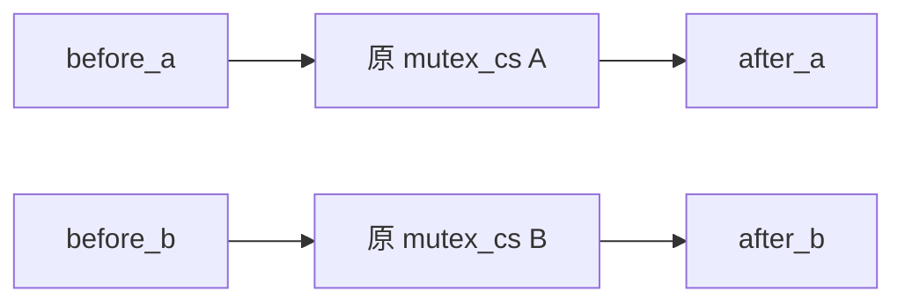
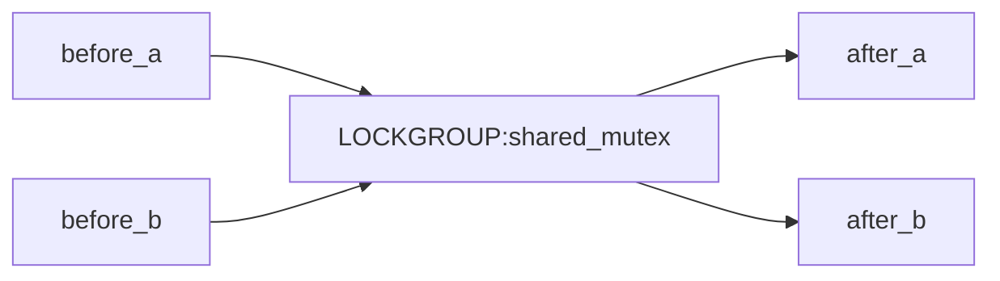

# Lock L1 证据报告

日期：2026-10-30。结论：**单 mutex、两个不同线程、各一次完整临界区的保守 DAG 收缩，在下述精确输入范围内完成。** 本轮不实施 L2，不改变运行时锁协议，不将汇总优先级写回线程。

## 1. 基线与支持范围

Condition C1–C4 最终 ZIP 为不可变基线：
`/home/spcae/Documents/Codex/2026-10-27/new-chat/outputs/condition_final/Code2DAG-condition-C1-C4-final-20261030.zip`
SHA-256 `d14d987ac3a97b7fda04c00d0615a82978615bfcd5f6deca0fea2b935b6c1f4c`。开始前重新计算并在结束时再次核对，未覆盖或修改。原有 34 项回归开始前全部通过、退出 0，见 [baseline_tests.stderr](baseline_tests.stderr)。

新的可选规则名为 `lock_grouped`，Level-2 默认仍为 `effective_line_merge`；Condition 规则不变。模型只改变 DAG 分析/调度视图。真实线程、lock/unlock 和计算语句保持原样，两个临界区依然各执行一次；本轮不安排两者真实先后，不声称分组图是可直接执行的线程调度。

本实现保守接受的源码是：一个直接命名的全局 `pthread_mutex_t`，以 `PTHREAD_MUTEX_INITIALIZER` 静态初始化；两个不同的直接 worker 函数，各有一个成对、独立行的 `pthread_mutex_lock(&mutex);` / `pthread_mutex_unlock(&mutex);`；中间包含正常的多行非空计算；每对 lock/unlock 所覆盖的有效源码恰好对应一个现有 `mutex_cs` 段。空白边缘可忽略，不切分或吞入外部计算。

为避免猜测，本轮词法验收还要求：main 中两次独立行的直接 pthread_create（NULL 属性和参数，不同具名句柄、每 worker 一次），随后各一次直接 join；调用图无递归，worker 不被其他位置调用/引用；函数为直线、非嵌套词法块，只允许末尾普通 return NULL/0。可调用同文件可见的无锁 helper，以及已知 puts/printf；未知外部/间接调用拒绝。只接受已列出的标准头文件 include，不分析任意宏、typedef 或自定义头文件。本轮没有为覆盖更广 C 形式而增加解析器。

**不支持且拒绝**：别名/指针传递、包装 lock/unlock、trylock、递归/属性锁、读写锁、信号量、多个 mutex、嵌套/交叉/重复/不配对锁、条件/循环中的锁、早期转移、不完整或跨多执行段临界区，以及上述词法形式之外的未经验证输入。模型不会通过猜测对未支持形式生成调度结果。

## 2. 修改文件和函数

| 文件 | 修改内容 |
|---|---|
| 新增 pipeline/lock_model.py | LockModelError、_require、analyze_lock_l1：严格词法范围和单次线程验证；build_lock_views：检查完整原段、构建两视图/映射、边收缩和循环拒绝；aggregate_lock_timing：导入字段校验和成员逐字段求和 |
| 新增 pipeline/rules/lock_rule.py | LockGroupedRule.rule_id/level/build/to_dot，复用既有 Level-2 分段器，不修改分段器 |
| 新增 pipeline/lock_timing.py | import_lock_timing/main：只读取原有 timing JSON，校验源文件 SHA，发布分组 timing.json；不生成或运行 C |
| 修改 pipeline/rules_registry.py | 独立注册 lock_grouped，原规则和默认选择不变 |
| 修改 pipeline/timing.py::run_timing | 仅对 timing_compatible=false 的分析模型明确拒绝 C 计时；未设置该字段的原流程不变 |
| 修改 pipeline/instrument.py::run_instrument | 仅对 instrumentation_compatible=false 拒绝 C 插桩和写回 |
| 修改 pipeline/instrument_levelx.py::instrument_prio_all_segments_by_start_line | 同样保护直接调用路径，防止绕过 pipeline 生成 C |
| 新增 tests/test_lock_l1.py | 17 项回归及 native_acceptance、fixture/model/timing_for 验收辅助 |
| 新增 source_files/lock_l1/lock_l1.c | 原生双线程、单 mutex 的只读分析输入，worker/main 不被插桩 |
| 新增 docs/lock_l1_validation.md | 本报告镜像 |

唯一四个原有文件的改动是规则注册及分析模型拒绝 C 的入口保护；没有重构。Condition 模型/规则/34 项测试、全部已有 C、所有算法源文件均哈希不变，见 [immutable_baseline_checks.json](immutable_baseline_checks.json)。共享保护只影响显式带新禁止能力字段的模型。五种算法以及 schedule.py 均没有修改。

## 3. 结构视图与分组视图

原生输入由 GCC13 从本轮源码生成 RTL expand 和基础元数据，再使用原 Level-2 分段。没有复用 Condition/dag5 的 DAG 或 Windows expand。

| 成员 | 原始 DAG 节点 / 执行段 ID | lock | 实际计算区域 | unlock |
|---|---|---|---|---|
| A | MU:thread_a#002@8-11 | 第 8 行 | 第 9–10 行 | 第 11 行 |
| B | MU:thread_b#002@18-21 | 第 18 行 | 第 19–20 行 | 第 21 行 |

结构视图保留上述两完整段，并在每段 lock_group 中记录 mutex_id、lock_range/unlock_range、critical_range、segment_range、function、group_id。分组视图删除这两个段，仅新增 `LOCKGROUP:shared_mutex`；汇总节点恰有上述两成员，member_node_ids 和 member_segment_ids 分别明确保存。

两个成员 DAG 节点本来就各是一个完整执行段，故两组 ID 在本例相同；这不意味着底层原始调用节点只有两个。原始调用仍在映射中逐项追溯。





上图只展示局部收缩；完整 create/join 依赖在 JSON/DOT 中。结构图 10 节点 / 11 边；分组图 9 节点 / 11 边，两者拓扑排序通过。group 的 function 为 `<lockgroup>`、synthetic=true、analysis_only=true；start/end 是兼容现有算法字段所需的包络数值，不代表跨函数可执行源码区域。真实源码范围只能查 members，禁止对包络插桩。

完整文件：`native_acceptance/native/intermediate_results/lock_l1/pipeline/blocks/level2/lock_grouped/` 下 segments_struct.json、dag_struct.json、segments_sched.json、dag_sched.json 及兼容别名、DOT；[前后图对照](graph_comparison.json)。本轮未要求或伪造图像渲染。

## 4. 边收缩、去重与环拒绝

成员外部入边统一改指 G，外部出边统一改自 G；内部成员边仅删除并保存于 removed_internal_edges。不会新增 A→B 或 B→A。按 (新 src、新 dst、原 kind) 去重；不同 kind 分别保留，每个去重结果的 provenance 包含所有 base_edge_index 与完整原 edge 字典，因此类型、自定义来源信息均可恢复。

原生图前后边类型均为 {'intra': 7, 'create': 2, 'join': 2}。原生例没有需要合并的同端点重复边；另用确定性图专门覆盖 create/join/sem_dep/intra 外部并集及重复投影，20 条原边收缩为 10 条唯一边，每条来源均保留，见 [dedup_graph_evidence.json](dedup_graph_evidence.json)。该 sem_dep 测试只是对已有边类型的保留，不是新增源码信号量支持；含 sem 源码仍明确拒绝。

环用例的原 DAG 为 `A→X→B`（原图无环）。收缩得到 `G→X→G`，**两条边原样保留**，capabilities.scheduler_compatible=false，记录 blocked_reasons，五种 schedule 入口均抛出明确错误，未调用算法产生结果。见 [cycle_rejection.json](cycle_rejection.json) 与对应回归。没有删除外部依赖来消环。

## 5. 权重计算证据

本轮使用**合成、确定性、现有 timing schema 的输入 JSON**验证聚合，不是测量值、不代表性能或 WCET。不会为获得数据而插桩或运行 C。成员权重是完整现有 mutex_cs 段的原权重，可能含该原段已经计入的 API 成本；不会额外估计或添加等待时间。

| 节点 | total_ns | count | avg_ns | min_ns | max_ns |
|---|---:|---:|---:|---:|---:|
| MU:thread_a#002@8-11 | 120 | 2 | 60 | 48 | 72 |
| MU:thread_b#002@18-21 | 180 | 2 | 90 | 72 | 108 |
| LOCKGROUP:shared_mutex | 300 | 4 | 150 | 120 | 180 |

这五个现有字段分别求和，未使用 max 代替相加。时间字段分别表示成员总时间之和、均值之和、样本最小值之和、样本最大值之和。count 相加表示贡献的真实成员样本总数，**不是虚拟汇总节点的实测执行次数**；avg_ns 是成员均值之和，不能再拿汇总 total_ns/count 重算。所有语义写入 lock_aggregation；sum(min_ns)/sum(max_ns) 也不是对整个汇总节点进行过测量的极值或经过证明的 WCET。

要求所有原执行段均有且仅有一份 timing 权重，base_name 匹配；成员五个字段任一缺失、缺成员、count=0、负数、非整数、未知字段或错误范围均报错，不静默填 0。未分组的纯阻塞段可保留原来 count=0/全零字段，未经修改。源文件相对 blocks 的 SHA 发生变化时拒绝导入。

[输入 JSON](native_acceptance/member_timing_input.json)、[聚合算式](weight_calculation.json)；发布位置为 `.../pipeline/timing/level2/lock_grouped/timing.json`。这是一条分析导入路径，不能调用普通 timing 为虚拟汇总节点生成 C。测试故意调用普通 timing 被拒绝后重新导入了分析权重；旧 timing_meta 中的失败是这次保护测试记录，不是实际计时失败或已经执行了计时。

## 6. 映射证据

[mapping_evidence.json](mapping_evidence.json) 提供：

| 查询 | 字段 |
|---|---|
| 原始调用/函数节点→汇总或未变节点 | original_node_to_grouped_node |
| 原始执行段→汇总或自身 | original_segment_to_grouped_node |
| 汇总→两个成员 DAG 节点 | grouped_node_to_member_nodes |
| 汇总→两个成员执行段 | grouped_node_to_member_segments |
| 汇总→mutex、成员函数和全部源码范围 | grouped_node_to_mutex_and_source |
| 原始调用→原执行段（保留追溯） | original_node_to_execution_segment |

例如 thread_a/pthread_mutex_lock1、thread_a/pthread_mutex_unlock2 原来都属于 MU:thread_a#002@8-11，分组后都查到 LOCKGROUP:shared_mutex；B 同理。main/create/join、两个 before/after 段均保持原映射。结构 node_to_segment 完全保留；分组 node_to_segment 仅替换成员目标。输入数据未原地修改，自带不相关 mappings 元数据也保留。

## 7. 五算法结果

所有结果只属于分析 DAG，**不写回任何真实线程**：

| 算法 | LOCKGROUP 优先级 | 全部节点优先级数量 | schedule 命令退出码 |
|---|---:|---:|---:|
| FIFO | 99 | 9 | 0 |
| LPF | 96 | 9 | 0 |
| heft | 95 | 9 | 0 |
| t_level | 95 | 9 | 0 |
| zhao2020 | 96 | 9 | 0 |

五算法均为分组后全部 9 节点生成 1..99 范围内优先级，原成员不再出现。模型仅保守汇总工作量及外部屏障依赖；没有使其等价于真实两线程执行的证明，也没有真实性能实验。

## 8. 拒绝用例与测试覆盖

[rejection_cases.json](rejection_cases.json) 保留独立核对的 14 种错误及具体原因：不配对、嵌套、条件、循环、trylock、别名、包装、信号量、第二 mutex、早退、rwlock、mutex 属性、分裂段、吞入外部代码的过大段，均明确拒绝。环模型单独标记不兼容并拒绝调度；缺失/非法权重在回归中逐字段检查。

新增 17 项测试覆盖用户要求：正常双线程收缩和精确两成员；外部入/出边并集；去重及完整 provenance；create/join/sem_dep/intra 保留；内部边删除不选顺序；五字段权重；原始节点/执行段/组反查映射和非成员不变；无环与五算法；不配对/嵌套/别名/包装/控制流/跨段拒绝；成环保留依赖且拒绝五调度；默认规则不变；原 C SHA 不变；直接插桩入口拒绝且不落盘；CRLF/注释伪 API 不误识别；原生 fresh generation→blocks→权重导入→schedule。

测试命令及结果，cwd=`/home/spcae/code2dag-condition`：

| 命令 | 结果 |
|---|---|
| python3 -B -m unittest discover -s Code2DAG/tests -v（修改前） | 34 项通过，退出 0，baseline_tests.stderr |
| python3 -B -m unittest Code2DAG.tests.test_lock_l1 -v | 17 项通过，退出 0，lock_tests.stderr |
| python3 -B -m unittest discover -s Code2DAG/tests -v（最终） | 51 项通过，退出 0、无跳过，final_tests.stderr |

Condition 原有 34 项在联合回归中保留原有原生测试行为；它们的既有 C 执行不构成 L1 新运行实验。L1 自身只编译生成对象和 expand，没有链接或执行优先级程序。

独立持久验收：

```bash
python3 /home/spcae/Documents/Codex/2026-10-27/new-chat/outputs/lock_l1/run_acceptance.py
```

退出 0；[12 条精确子命令](native_acceptance/commands.json) 全部退出 0，各命令 stdout/stderr 保存在 logs。包括 GCC13 `-O0 -g -fdump-rtl-expand -c`、generation threads/full、collect、默认/Lock 两个 blocks、Lock timing JSON 导入及五算法 schedule。没有运行 L1 app。目录已存在时脚本拒绝覆盖，复跑须提供新的输出目录。

可用的分组命令：

```bash
python3 -m Code2DAG.pipeline.cli --base-dir <native> blocks --base-name lock_l1 --source <原C> --level level2 --rule lock_grouped
python3 -m Code2DAG.pipeline.lock_timing --base-dir <native> --base-name lock_l1 --input-timing <已有原段权重.json>
python3 -m Code2DAG.pipeline.cli --base-dir <native> schedule --base-name lock_l1 --level level2 --rule lock_grouped --algo FIFO
```

末条分别用于五算法；输入文件/精确绝对路径见 commands.json。反例 timing、instrument 调用均在生成 C 前明确失败；直接 instrument_levelx 也不能绕过。保护拒绝原因保存在 acceptance.json 中。未产生 L1 timing/project/*.c 或 instrument/**/*.c，没有调用 pthread_setschedparam。

## 9. 原 C SHA 与不变量

原生用例 `Code2DAG/source_files/lock_l1/lock_l1.c` 分析前后均为：

```text
81b434593a4927a735fc36feafe1d895337e3dbcea37f8477b32e206a6980908
```

source_after_sha256 相同；所有基线已有 C 文件也哈希不变。generation/collector 可能保存原源码的未修改配置副本，但不会生成插桩源码。没有改变原始线程、临界区、锁调用及实际次数；本轮不通过执行轨迹推断实际锁顺序。

交付包括 [changes.patch](changes.patch)（仅四个原有文件的最小差异）、[change_audit.json](change_audit.json)、[完整原生验收摘要](native_acceptance/acceptance.json)、本轮新增/修改文件的 lock_l1_changes.zip 和哈希清单。使用不可变 Condition 最终基线加本轮变更包可恢复 L1 代码，不覆盖 Condition 快照。

## 10. 已知限制及停止范围

这只是单组、两成员、单次执行的 DAG 保守收缩。额外词法限制详见第 1 节，未支持输入必须拒绝；不承诺完整 C、任意初始化/属性、外部 helper、指针解析、宏和复杂控制流。

本轮合成 timing 只验证已有字段运算，既不估计 mutex 等待，也不声称 WCET、性能提升、实际临界区顺序或分组调度与真实执行等价。汇总优先级不下发，故不涉及 FIFO/EPERM 生效试验。环拒绝是图收缩兼容性检查，不是运行时死锁检测。

没有新增 PI、优先级冻结、计算就绪、锁运行协议或新的调度算法。Condition 不扩展；Lock L1 到此停止，不开始 L2。
